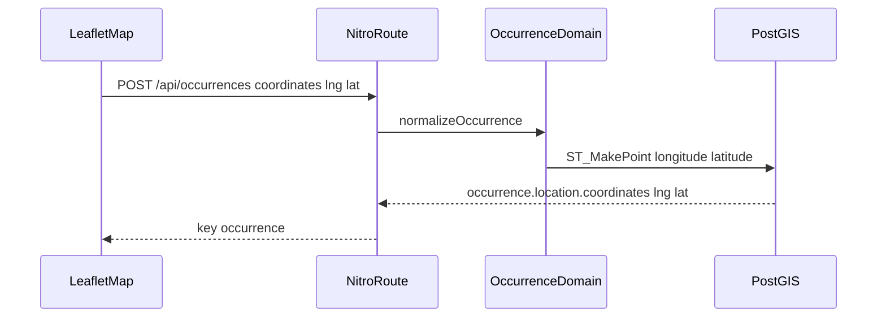

# Contrato occurrence Design

**Spec**: `.specs/features/contrato-occurrence/spec.md`
**Status**: Approved
**Approved**: 2026-11-09 - user: "Implement the plan as specified, it is attached for your reference."

---

## Architecture Overview

O typo `ocurrence` vira `occurrence` em tabela, arquivo de rota, chave JSON e identificador. A init permanece. Uma migration nova renomeia tabela, coluna, índice e foreign key. O pedido passa a ler o par GeoJSON que a resposta já devolve. A lista do usuário deixa de montar links.



AD-001 está `superseded by AD-003`. AD-002 permanece: Prisma 7 e ponto `Unsupported`, com SQL cru para gravar e ler.

## Code Reuse Analysis

### Existing Components to Leverage

| Component | Location | How to Use |
| --- | --- | --- |
| `requestPoint` e `geoJsonCoordinates` | `server/domain/occurrences/create.ts` | `requestPoint` passa a ler índice 0 como longitude. `geoJsonCoordinates` já devolve `[longitude, latitude]`. |
| `sliceMine` | `server/domain/occurrences/mine.ts` | Continua cortando de 10. `toMineResponse` devolve só quatro chaves. |
| `readPage` | `server/api/ocurrences/my-ocurrences.get.ts` | Muda de pasta com a rota. Página inválida continua 1. |
| `resetTestDatabase` | `server/db/migrate.ts` | O `TRUNCATE` usa os nomes novos. |
| `seedTypeOcurrences` | `prisma/seed.ts` | O client vira `typeOccurrence`. Renomear a função para `seedTypeOccurrences`. |
| Testes em `test/server/` | vitest | Atualizar caminho, chave e par. Não apagar teste para a suíte passar. |

### Integration Points

| System | Integration Method |
| --- | --- |
| Nitro | O arquivo da rota é o caminho. `server/api/ocurrences/` sai. `server/api/occurrences/` entra. |
| Prisma Client | Models `Occurrence`, `TypeOccurrence`, `LikeOccurrence`. Campo `occurrence_id`. |
| Leaflet | Marcador continua `[lat, lng]`. Só o payload de criar usa `toRequestCoordinates`. |
| Front | `$fetch` aponta para `occurrences`, `my-occurrences` e `types-occurrence`. |

---

## Components

### Rename da migration

- **Purpose**: Levar um banco que já aplicou a init aos nomes novos.
- **Location**: `prisma/migrations/20261109213000_rename_ocurrence/migration.sql`
- **Interfaces**: SQL `ALTER TABLE ... RENAME` e `ALTER INDEX` / `RENAME CONSTRAINT` para os nomes que o Prisma gera.
- **Dependencies**: `prisma/migrations/20261109120000_init/migration.sql` permanece.
- **Reuses**: Os nomes de índice e FK da init.

Nomes finais:

- `types_ocurrence` → `types_occurrence`
- `ocurrences` → `occurrences`
- `like_ocurrences.ocurrence_id` → `occurrence_id`, depois a tabela → `like_occurrences`
- `types_ocurrence_name_key` → `types_occurrence_name_key`
- `like_ocurrences_user_id_ocurrence_id_key` → `like_occurrences_user_id_occurrence_id_key`
- `ocurrences_type_id_fkey` → `occurrences_type_id_fkey`
- `ocurrences_user_id_fkey` → `occurrences_user_id_fkey`
- `like_ocurrences_user_id_fkey` → `like_occurrences_user_id_fkey`
- `like_ocurrences_ocurrence_id_fkey` → `like_occurrences_occurrence_id_fkey`

### Models Prisma

- **Purpose**: O client tipado usa os nomes novos.
- **Location**: `prisma/schema.prisma`
- **Interfaces**: `TypeOccurrence` com `@@map("types_occurrence")`, `Occurrence` com `@@map("occurrences")`, `LikeOccurrence` com `occurrence_id` e `@@map("like_occurrences")`.
- **Dependencies**: Migration de rename.
- **Reuses**: Colunas atuais. `location` continua `Unsupported("geometry(Point, 4326)")`.

### Ponto

- **Purpose**: Um par, nos dois sentidos.
- **Location**: `server/domain/occurrences/create.ts` e `utils/occurrencePoint.ts`
- **Interfaces**:
  - `requestPoint(coordinates: [number, number]): { latitude: number; longitude: number }` — índice 0 é longitude
  - `toRequestCoordinates(latitude: number, longitude: number): [number, number]` — devolve `[longitude, latitude]`
- **Dependencies**: Nenhuma lib nova.
- **Reuses**: `geoJsonCoordinates`.

`LeafletMap.vue` chama `toRequestCoordinates(lat, lng)` no payload. A leitura do marcador continua `coordinates[1]`, `coordinates[0]`, porque a resposta já é GeoJSON.

### Lista do usuário

- **Purpose**: Quatro chaves, sem link do Laravel.
- **Location**: `server/domain/occurrences/mine.ts`
- **Interfaces**: `toMineResponse(page): { data, page, per_page, total }`. Sem argumento de path.
- **Dependencies**: `sliceMine`.
- **Reuses**: `MINE_PAGE_SIZE` 10.

O domínio não importa `interfaces/IPaginationLink`. Se ninguém mais importar, o arquivo sai.

### Rotas e front

- **Purpose**: O caminho HTTP e o `$fetch` usam o mesmo nome.
- **Location**: `server/api/occurrences/`, `server/api/types-occurrence.get.ts`, composables, store, `pages/my-occurrences.vue`, `components/layout/Navbar.vue`
- **Interfaces**:
  - lista ativa `{ occurrences }`
  - criar e curtir `{ occurrence }`
  - tipos `{ types_occurrence }`
  - minhas `{ data, page, per_page, total }`
- **Dependencies**: Domínio já renomeado.
- **Reuses**: Handlers atuais, só mudam pasta, chave e URL.

Regra de rename: toda ocorrência do typo `ocurrence` em caminho, SQL, chave e identificador vira `occurrence`. Texto em português (`Ocorrências`, `Minhas Ocorrências`) e os arquivos `stores/ocorrencias.ts` e `interfaces/Ocorrencia.ts` ficam.

---

## Data Models

### MinePageResponse

```typescript
interface MinePageResponse {
  data: ListedOccurrence[]
  page: number
  per_page: number
  total: number
}
```

**Relationships**: `data` é a página de `occurrences` do usuário, ativas e inativas.

### Point

```typescript
interface RequestPoint {
  type: "Point"
  coordinates: [number, number] // [longitude, latitude]
}
```

**Relationships**: `ST_MakePoint(longitude, latitude)` com SRID 4326. A resposta repete o mesmo par.

---

## Error Handling Strategy

| Error Scenario | Handling | User Impact |
| --- | --- | --- |
| Par que não tem dois números finitos | 422, sem insert | O mapa não ganha pino |
| `page` omitida, não inteira ou menor que 1 | `page` 1 | A primeira página abre |
| `page` além do fim | `data: []`, `total` real | A paginação não inventa linha |
| Token ausente em criar, curtir e minhas | 401, como hoje | A tela pede login |

---

## Risks & Concerns

| Concern | Location (file:line) | Impact | Mitigation |
| --- | --- | --- | --- |
| SQL cru com o nome antigo da tabela | `server/domain/occurrences/list-active.ts:127` | A query quebra depois do rename | A mesma tarefa que migra o banco troca o SQL e o `TRUNCATE` |
| Testes inserem em `ocurrences` e mandam latitude primeiro | `test/server/api/ocurrences/index.post.test.ts:64` | A suíte mente sobre o eixo se a asserção for afrouxada | O teste `stores and returns longitude first` exige o par `[-46.633308, -23.55052]` na ida, no `ST_X`/`ST_Y` e na volta |
| Popup interpola endereço em HTML | `utils/mapPopup.ts:55` | XSS já existente | Este corte não mexe no HTML do popup |
| `deleteOcurrence` chama uma rota que não existe | `composables/ocurrencesService.ts:51` | Continua 404 | O typo no path acompanha o rename. A rota DELETE não nasce |

---

## Tech Decisions

| Decision | Choice | Rationale |
| --- | --- | --- |
| Eixo | GeoJSON nos dois sentidos | AD-003 |
| Histórico da migration | `RENAME` novo, init intacta | Checksum de banco já migrado |
| Chave do catálogo | `types_occurrence` | O typo sai de toda chave |
| Verbo do like | GET | Fora deste corte |
| Helper do mapa | `utils/occurrencePoint.ts` | O vitest alcança a regra sem montar o Vue |
