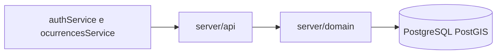
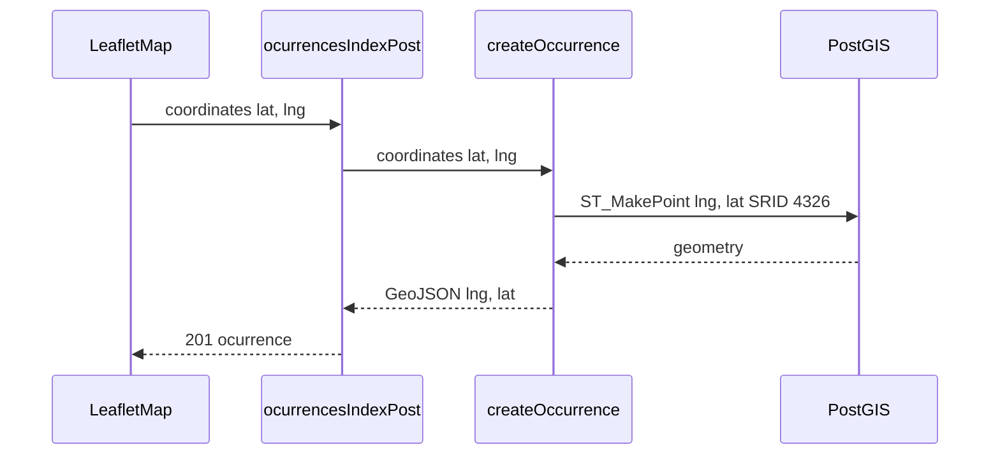

# Migração do backend Design

**Spec**: `.specs/features/migrar-backend/spec.md`
**Context**: `.specs/features/migrar-backend/context.md`
**Status**: Approved

---

## Architecture Overview

As regras que mudam o que o mapa mostra ficam em `server/domain`. As rotas em `server/api` só traduzem HTTP. O PostgreSQL com PostGIS guarda o ponto. O front continua nos composables atuais; a última tarefa aponta `NUXT_PUBLIC_API_BASE` para este Nitro.



Pedido de ocorrência:



`server/api/reverse-geocoding.ts` permanece. Nenhuma rota nova usa esse caminho.

---

## Code Reuse Analysis

### Existing Components to Leverage

| Component | Location | How to Use |
| --- | --- | --- |
| Cliente HTTP do mapa | `composables/authService.ts`, `composables/ocurrencesService.ts` | Não mudam os sufixos. Só a base URL na última tarefa. |
| Contrato TypeScript | `interfaces/IOcurrence.ts`, `interfaces/IUser.ts`, `interfaces/responses/MyOcurrencesResponse.ts` | O JSON novo tem de caber nesses tipos. |
| Eixo do pino | `components/map/LeafletMap.vue` | Envia `[lat, lng]` e desenha `[coordinates[1], coordinates[0]]`. O backend preserva essa troca. |
| Geocodificação | `server/api/reverse-geocoding.ts` | Continua no Nitro, fora das rotas migradas. |
| Frases e limites | FormRequests e testes Feature em `mapa_cidadao_api` | Copiar os valores, não o PHP. |

### Integration Points

| System | Integration Method |
| --- | --- |
| Front Nuxt | `runtimeConfig.public.apiBase` + os sufixos já escritos nos composables |
| PostgreSQL/PostGIS | `DATABASE_URL`, pacote `postgres`, SQL em `server/db` |
| DNS do e-mail | `node:dns/promises` `resolveMx`, trocável por injeção no teste |

---

## Components

### Banco e migração

- **Purpose**: Sobe o PostGIS, cria as tabelas e insere os cinco tipos.
- **Location**: `docker-compose.yml`, `server/db/schema.sql`, `server/db/seed.sql`, `server/db/client.ts`, `server/db/migrate.ts`
- **Interfaces**:
  - `getSql(): Sql` — pool a partir de `DATABASE_URL`
  - `migrate(sql: Sql): Promise<void>` — aplica schema e seed
- **Dependencies**: imagem `postgis/postgis:16-3.4`, pacote `postgres`
- **Reuses**: colunas de `database/migrations` da API Laravel, sem sessão, cache, jobs, reset de senha, `email_verified_at` nem `remember_token`

### Cadastro e sessão

- **Purpose**: Valida o cadastro, confere a senha e emite ou revoga o token.
- **Location**: `server/domain/auth/register.ts`, `server/domain/auth/session.ts`, `server/domain/auth/email-domain.ts`
- **Interfaces**:
  - `validateRegistration(input, domainCheck): { ok: true, value } | { ok: false, errors }`
  - `emailDomainAcceptsMail(email: string): Promise<boolean>`
  - `registerUser(sql, input): Promise<{ user, token }>`
  - `login(sql, email, password): Promise<{ user, token } | null>`
  - `readSession(sql, token): Promise<{ user, token } | null>`
  - `logout(sql, token): Promise<boolean>`
- **Dependencies**: `bcryptjs` custo 12, `node:crypto` SHA-256 do token
- **Reuses**: frases de `RegisterUserRequest.php` e status de `RegisterControllerFTest.php` e `AuthControllerFTest.php`

### Ocorrências

- **Purpose**: Lista, cria, inativa, pagina e alterna a curtida.
- **Location**: `server/domain/catalog/list-types.ts`, `server/domain/occurrences/list-active.ts`, `server/domain/occurrences/create.ts`, `server/domain/occurrences/inactivate.ts`, `server/domain/occurrences/mine.ts`, `server/domain/occurrences/like.ts`, `server/domain/geo.ts`
- **Interfaces**:
  - `requestPoint(coordinates: [number, number]): { latitude: number, longitude: number }` — índice 0 é latitude
  - `geoJsonCoordinates(latitude: number, longitude: number): [number, number]` — `[longitude, latitude]`
  - `listTypes(sql)`
  - `listActive(sql, userId: number | null)`
  - `createOccurrence(sql, userId, body)`
  - `inactivateOccurrence(sql, userId, id, body)`
  - `listMine(sql, userId, page: number)`
  - `toggleLike(sql, userId, id)`
- **Dependencies**: PostGIS `ST_MakePoint`, `ST_X`, `ST_Y`, `ST_AsGeoJSON`
- **Reuses**: `OcurrenceService.php` e o teste Feature de ocorrências

### Rotas HTTP

- **Purpose**: Lê o bearer, chama o domínio e devolve o status do spec.
- **Location**: arquivos em `server/api` listados em Data Models
- **Interfaces**: cada arquivo exporta o handler do Nitro. `bearerToken(header: string | undefined): string | null` aceita `Bearer` e `bearer`. Header ausente ou vazio vira `null`.
- **Dependencies**: handlers do domínio
- **Reuses**: sufixos de `authService.ts` e `ocurrencesService.ts`

Validação 422 usa `{ message, errors }`. `message` é a primeira frase de `errors`. Falha de banco não tratada responde 500 e não deixa meia linha: cadastro, criação e inativação rodam numa transação.

---

## Data Models

### User

```typescript
interface User {
  id: number
  name: string
  email: string
  date_birth: string
  created_at: string
  updated_at: string
}
```

**Relationships**: um usuário tem muitas ocorrências e muitas curtidas. A coluna `password` existe na tabela e não sai no JSON.

### AccessToken

```typescript
interface AccessToken {
  id: number
  user_id: number
  token_hash: string
  created_at: string
}
```

**Relationships**: pertence a um usuário. A string entregue ao cliente não é gravada; só o SHA-256.

### TypeOcurrence

```typescript
interface TypeOcurrence {
  id: number
  name: string
  created_at: string
  updated_at: string
}
```

**Relationships**: um tipo tem muitas ocorrências. O seed insere os cinco nomes e não duplica se rodar de novo.

### Ocurrence

```typescript
interface Ocurrence {
  id: number
  location: { type: "Point"; coordinates: [number, number] }
  type_id: number
  type: TypeOcurrence
  user_id: number
  description: string
  address_name: string
  city: string | null
  state: string | null
  country: string | null
  is_active: boolean
  type_closure: "resolved" | "mistake" | "other" | null
  solution_description: string | null
  resolution_date: string | null
  created_at: string
  updated_at: string
  liked_by_auth_user: boolean
  likes_count: number
}
```

**Relationships**: pertence a um usuário e a um tipo. `location` na tabela é `geometry(Point, 4326)`.

### LikeOcurrence

```typescript
interface LikeOcurrence {
  id: number
  user_id: number
  ocurrence_id: number
  created_at: string
  updated_at: string
}
```

**Relationships**: única em `(user_id, ocurrence_id)`. Apagar a ocorrência apaga as curtidas.

### Tabelas

- `users` — id, name, email único, password, date_birth, created_at, updated_at
- `access_tokens` — id, user_id, token_hash único, created_at
- `types_ocurrence` — id, name, created_at, updated_at
- `ocurrences` — id, location `geometry(Point, 4326)`, type_id, user_id, description `text not null default ''`, address_name `text not null default ''`, city, state, country, is_active `default true`, type_closure com check `resolved|mistake|other`, solution_description, resolution_date `date`, timestamps
- `like_ocurrences` — id, user_id, ocurrence_id, timestamps, unique `(user_id, ocurrence_id)`

Inserção do ponto: `ST_SetSRID(ST_MakePoint(longitude, latitude), 4326)` com latitude em `coordinates[0]` e longitude em `coordinates[1]`. Leitura: `ST_Y` é latitude, `ST_X` é longitude, e o JSON monta `[ST_X, ST_Y]`.

### Rotas

| Arquivo | HTTP |
| --- | --- |
| `server/api/register.post.ts` | POST /api/register |
| `server/api/user/login.post.ts` | POST /api/user/login |
| `server/api/user/me.get.ts` | GET /api/user/me |
| `server/api/user/logout.post.ts` | POST /api/user/logout |
| `server/api/types-ocurrence.get.ts` | GET /api/types-ocurrence |
| `server/api/ocurrences/index.get.ts` | GET /api/ocurrences |
| `server/api/ocurrences/index.post.ts` | POST /api/ocurrences |
| `server/api/ocurrences/inactivate/[id].post.ts` | POST /api/ocurrences/inactivate/:id |
| `server/api/ocurrences/my-ocurrences.get.ts` | GET /api/ocurrences/my-ocurrences |
| `server/api/ocurrences/like/[id].get.ts` | GET /api/ocurrences/like/:id |

Testes de rota importam o handler e usam `callHandler` do `h3`. Não sobem o `nuxt dev`. O teste de caminhos confere os dez arquivos e chama um handler que já responde.

---

## Error Handling Strategy

| Error Scenario | Handling | User Impact |
| --- | --- | --- |
| Cadastro inválido | 422 `{ message, errors }` | O toast mostra `message`. O campo fica em `errors`. |
| Login ruim | 401 `{ message: "Credenciais inválidas" }` | O front mostra a frase. |
| Token ausente ou desconhecido numa rota protegida | 401 | A tela trata como sessão inválida. |
| Listagem pública sem token | 200 e `liked_by_auth_user` false | O mapa abre sem login. |
| Inativar ocorrência de outro | 403 com a frase do spec | O mapa avisa que não pode encerrar. |
| Já inativa, payload ruim ou falha ao gravar | 422 com a frase do spec | Nada muda na linha, exceto a falha de gravação que não confirma o encerramento. |
| Id inexistente em inativar ou curtir | 404 | O front cai no erro genérico que já tem. |
| Banco rejeita a transação | 500 e rollback | Nenhuma linha parcial de cadastro, criação ou inativação. |

---

## Risks & Concerns

| Concern | Location (file:line) | Impact | Mitigation |
| --- | --- | --- | --- |
| O mapa envia latitude no índice 0 e lê longitude no índice 0 | `components/map/LeafletMap.vue:232` e `components/map/LeafletMap.vue:140` | Inverter um dos lados desloca todos os pinos | `requestPoint` e `geoJsonCoordinates` com o exemplo de São Paulo no teste de criação |
| `makeGeodetic` trata o índice 0 como latitude e o GeoJSON devolve longitude primeiro | `mapa_cidadao_api/app/Services/OcurrenceService.php:18` e `vendor/clickbar/laravel-magellan/src/IO/Generator/Geojson/GeojsonGenerator.php:28` | O comentário do teste PHP usa a ordem GeoJSON e não a ordem do front | O spec fixa `[-23.55052, -46.633308]` na ida e `[-46.633308, -23.55052]` na volta |
| `/me` cria token novo e não apaga o antigo | `mapa_cidadao_api/app/Http/Controllers/AuthController.php:75` | Tokens se acumulam | `readSession` devolve o mesmo token. O spec marca o desvio |
| `likes_count` e `liked_by_auth_user` disparam uma query por ocorrência | `mapa_cidadao_api/app/Models/Ocurrence.php:70` | A lista do mapa cresce em N+1 | `listActive` agrega as curtidas numa consulta |
| O front tem `DELETE /ocurrences/:id` sem rota | `composables/ocurrencesService.ts:53` | Quem chamar `removeOcurrence` continua sem backend | Fora de escopo. Nenhuma tarefa cria essa rota |
| Este repositório não tem runner de teste | `package.json:5` | A implementação não tem onde provar o spec | A fase 2 adiciona Vitest. Até lá estes documentos não rodam teste de API |
| Anotação Scribe diz 201 no cadastro e o teste afirma 200 | `RegisterController.php:53` e `RegisterControllerFTest.php:27` | Implementar 201 quebra a paridade com o teste Laravel | O spec fica em 200, com Confirmed `n` para correção antes de codar |

---

## Tech Decisions

| Decision | Choice | Rationale |
| --- | --- | --- |
| Acesso ao banco | `postgres` e SQL | PostGIS cabe em SQL. Um ORM não existe neste repositório e não acrescenta o eixo do ponto. |
| Testes | Vitest. Domínio em `server/domain/**/*.test.ts`. Rotas em `server/api/**/*.test.ts` com `callHandler` | Não há runner hoje. O domínio prova a regra. A rota prova o status e o JSON. |
| Banco de teste | O mesmo compose, database `mapa_cidadao_test`, `migrate` trunca e reinsere os tipos antes de cada arquivo de rota | O teste de integração vê PostGIS de verdade. |
| Senha | `bcryptjs` custo 12 | É o custo padrão do Laravel. Um hash antigo ainda confere se um dia houver cópia. |
| Token | 32 bytes em base64url, coluna com SHA-256 | O cliente só reenvia a string. O banco vazio não precisa do prefixo do Sanctum. |

AD-001 em `.specs/STATE.md` registra que a API deste produto mora aqui, em PostGIS.
