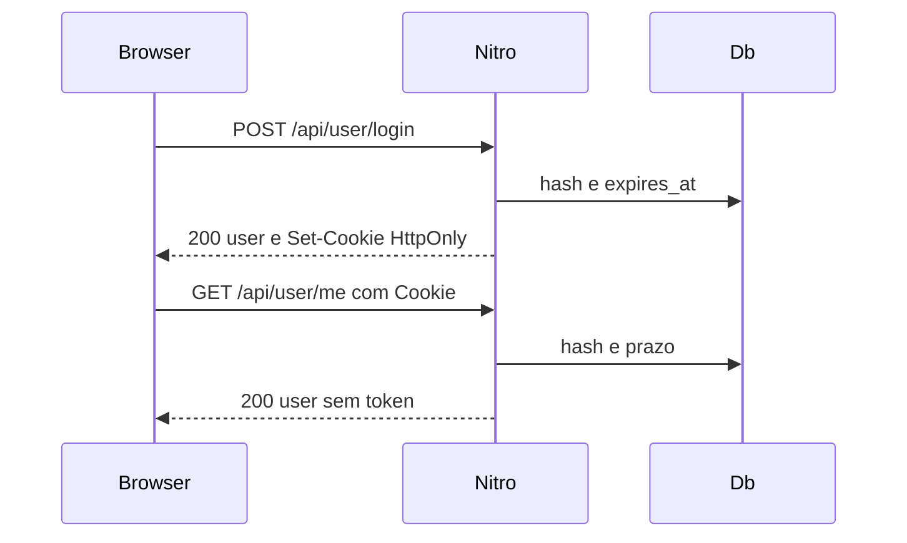

# Sessão cookie HttpOnly Design

**Spec**: `.specs/features/sessao-cookie/spec.md`
**Status**: Approved

**Approved**: 2026-11-09 - user: "Implement the plan as specified, it is attached for your reference."

---

## Architecture Overview

O segredo nasce no domínio, sai só no `Set-Cookie` e volta no header `Cookie`. O JavaScript guarda o `user` em memória. AD-002 continua: Prisma 7 e a coluna do ponto fora do client tipado. AD-003 continua: o ponto é GeoJSON. AD-004 fixa o cookie e o prazo.



---

## Code Reuse Analysis

### Existing Components to Leverage

| Component | Location | How to Use |
| --- | --- | --- |
| Token opaco e hash | `server/domain/auth/session.ts` | `createToken`, `hashToken`, `login`, `logout`, `readSession` |
| Cadastro | `server/domain/auth/register.ts` | Continua devolvendo o token ao handler. O handler não copia o token para o JSON |
| Chamada de handler | `server/test/call-handler.ts` | Passa a devolver `set-cookie` |
| Toast e mapa | `stores/authStore.ts`, `components/map/LeafletMap.vue` | O mapa já observa `authStore.user`. O login deixa de recarregar |

### Integration Points

| System | Integration Method |
| --- | --- |
| PostgreSQL | Coluna `access_tokens.expires_at`, preenchida nas linhas já existentes com `created_at + 7 dias` |
| Browser | `Set-Cookie` na resposta de `$fetch` same-origin. O plugin usa `useRequestFetch()` para o SSR encaminhar o cookie |

---

## Components

### Session cookie

- **Purpose**: Grava, lê e expira `auth_token`.
- **Location**: `server/domain/auth/cookie.ts`
- **Interfaces**:
  - `sessionCookieOptions(nodeEnv: string | undefined)` - flags do cookie. `secure` é true só quando o valor é `production`.
  - `setSessionCookie(event, token)` - `Max-Age=604800`.
  - `clearSessionCookie(event)` - `Max-Age=0` com o mesmo path, SameSite e Secure.
  - `readSessionCookie(event): string | null` - lê só o cookie. Ignora `Authorization`.
- **Dependencies**: `h3` `setCookie`, `getCookie`, `deleteCookie`.
- **Reuses**: o nome `auth_token` que o store já usava.

### Session lifetime

- **Purpose**: Recusa token vencido e grava `expires_at` no cadastro e no login.
- **Location**: `server/domain/auth/session.ts`
- **Interfaces**:
  - `SESSION_TTL_SECONDS = 604800`
  - `sessionExpiry(from: Date): Date`
  - `readSession` devolve null quando `expires_at` já passou.
- **Dependencies**: `AccessToken.expires_at`.
- **Reuses**: `hashToken` e `createToken`.

### Route session

- **Purpose**: As rotas protegidas pedem o usuário ao cookie. A lista pública trata cookie ausente ou inválido como anônimo.
- **Location**: `server/api/user/*.ts` e `server/api/occurrences/*.ts`
- **Interfaces**: o handler chama `readSessionCookie` e `readSession`. Sem sessão, a rota protegida responde 401 com "Não autenticado".
- **Dependencies**: `cookie.ts` e `session.ts`.
- **Reuses**: as mensagens e os status que as rotas já devolvem.

### Browser session

- **Purpose**: O store chama `/api` no mesmo origin e guarda só o `user`.
- **Location**: `stores/authStore.ts`, `stores/occurrencesStore.ts`, `plugins/auth.ts`, `middleware/authMiddleware.ts`
- **Interfaces**:
  - `getUser()` chama `GET /api/user/me` via `useRequestFetch()`.
  - O plugin chama `getUser()` na carga.
  - O middleware redireciona para `/` quando `user` está vazio.
- **Dependencies**: cookie gravado pelo Nitro.
- **Reuses**: toasts de sucesso do cadastro já existentes.

---

## Data Models

### AccessToken

```typescript
interface AccessToken {
  id: number
  user_id: number
  token_hash: string
  created_at: Date
  expires_at: Date
}
```

**Relationships**: `expires_at` é `created_at` mais 604800 segundos no cadastro e no login. O default do banco cobre insert que não mande a coluna: `NOW() + interval '7 days'`.

---

## Error Handling Strategy

| Error Scenario | Handling | User Impact |
| --- | --- | --- |
| Credencial ruim | 401 "Credenciais inválidas", sem Set-Cookie | Toast com essa frase |
| Cookie ausente, desconhecido ou vencido numa rota protegida | 401 "Não autenticado" | O plugin zera `user` |
| Logout com cookie ruim | 401 e Set-Cookie com Max-Age=0 | O browser solta o cookie |
| Lista pública com cookie ruim | 200, `liked_by_auth_user` false | O mapa continua anônimo |

---

## Risks & Concerns

| Concern | Location | Impact | Mitigation |
| --- | --- | --- | --- |
| Like GET com cookie | `server/api/occurrences/like/[id].get.ts` | Navegação cross-site pode curtir | Fora deste corte. O spec registra o limite |
| `callHandler` não lia `Set-Cookie` | `server/test/call-handler.ts` | O teste não via o cookie | A resposta do helper passa a incluir o header |
| Inserts de teste sem `expires_at` | `test/server/api/occurrences/*.test.ts` | Coluna obrigatória quebra o create | Default de 7 dias no banco, e os creates de teste passam a preencher a coluna |
| SSR não encaminha cookie num `$fetch` cru | `stores/authStore.ts` | O refresh perderia o usuário | `useRequestFetch()` no store e no plugin |

---

## Tech Decisions

| Decision | Choice | Rationale |
| --- | --- | --- |
| Onde o cookie é montado | `server/domain/auth/cookie.ts` | Um lugar só para as flags. As rotas não repetem `setCookie` |
| Bearer | As rotas não leem `Authorization` | AD-004. Um header com o segredo certo, sem cookie, responde 401 |
| Prova do cliente | Leitura dos arquivos em `test/server/app/session-client.test.ts` | O Vitest deste repo só inclui `test/server/**/*.test.ts`. Não há harness de Vue |

> A decisão de sessão está em AD-004. AD-002 e AD-003 seguem ativos.
